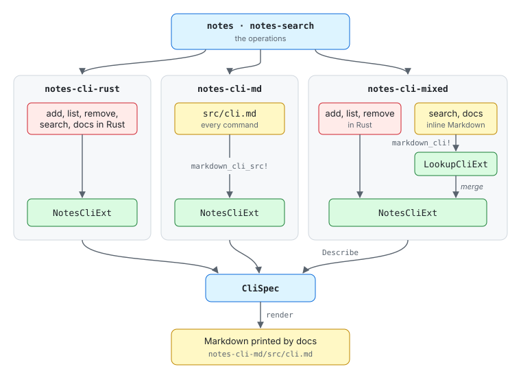
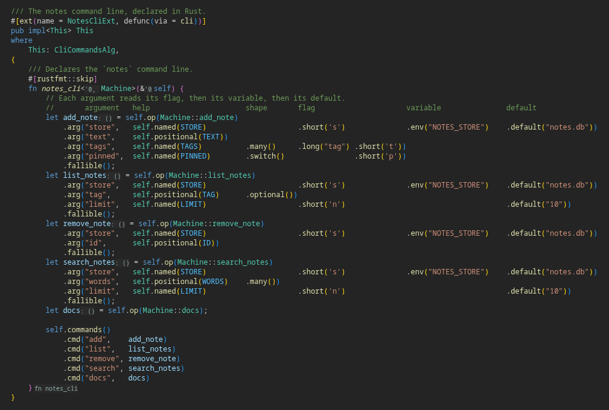
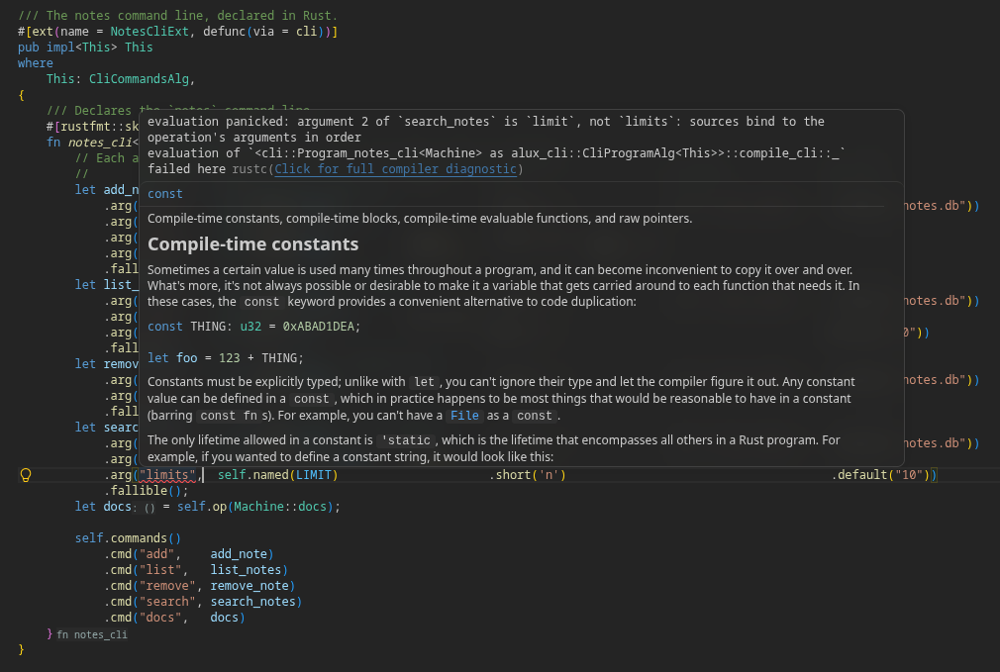
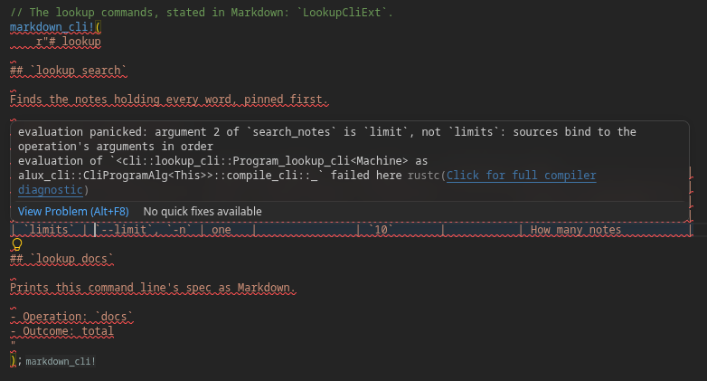
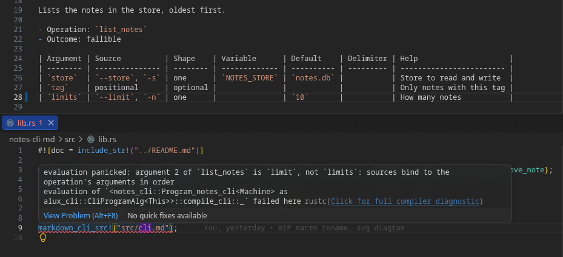

# ALUX CLI example

[](LICENSE)
[](rust-toolchain.toml)
[](https://crates.io/crates/alux-cli)

One command-line spec, two notations. An [`alux-cli`](https://docs.rs/alux-cli) program can be declared in Rust or written in Markdown, and each compiles to the other:

- **Rust → Markdown.** [`Describe`](crates/notes-cli-describe) is one more interpreter of the `alux-cli` algebras. It applies nothing and folds a program into a `CliSpec`, which [`notes-cli-markdown`](crates/notes-cli-markdown) renders.
- **Markdown → Rust.** `notes-cli-markdown` reads the same format back into a `CliSpec`, and [`notes-cli-rust-gen`](crates/notes-cli-rust-gen) generates the `#[ext(defunc(via = cli))]` declaration from it, which [`notes-cli-macro`](crates/notes-cli-macro) expands in place from a file or inline Markdown: the same aligned table a person writes.
- **Both, as commands.** Every binary has a `docs` command that folds its own program back to Markdown, so the spec a binary prints is the spec it runs.



## Specifications

What the notes app means, with no interpreter in it. They sit at the top level; `x-y` is `x` over `y`, and a specification stated over another is listed after it.

### The notebook

| Crate | | Responsibility |
| --- | --- | --- |
| [`notes`](notes) | ![meaning][b-meaning] | Notes in named stores, added, listed, removed |
| [`notes-search`](notes-search) | ![meaning][b-meaning] | Finding notes by their words |

### The command line, in three notations

One command line, stated three ways; each folds back to the same [`cli.md`](notes-cli-md/src/cli.md). `notes-cli-mixed` declares `add`, `list`, and `remove` in Rust and states `search` and `docs` in inline Markdown.

| Crate | | States the command line |
| --- | --- | --- |
| [`notes-cli-rust`](notes-cli-rust) | ![Rust][b-rust] | declared in Rust |
| [`notes-cli-md`](notes-cli-md) | ![Markdown][b-md] | stated in Markdown |
| [`notes-cli-mixed`](notes-cli-mixed) | ![Rust][b-rust] ![Markdown][b-md] | Rust and inline Markdown, merged |

In [Rust](notes-cli-rust/src/cli.rs), a command line reads as a table too: one row per argument, its help, shape, flag, variable, and default in columns.



## Interpretations

Interpreters, or implementations, of the specifications above, under [`crates/`](crates). The specifications use none of them, and each specification can have several.

### Of the notebook

| Crate | | Responsibility |
| --- | --- | --- |
| [`notes-files`](crates/notes-files) | ![library][b-lib] | The notebook in a store file |
| [`notes-memory`](crates/notes-memory) | ![tests][b-test] | The notebook in memory, for tests |
| [`notes-conformance`](crates/notes-conformance) | ![laws][b-laws] | The laws every interpreter passes |

### Of the command line

Each runs its spec with `alux-cli-direct` over `notes-files`.

| Crate | | Runs |
| --- | --- | --- |
| [`notes-cli-md-direct`](crates/notes-cli-md-direct) | ![binary][b-bin] | `notes-cli-md`, the default `cargo run` |
| [`notes-cli-rust-direct`](crates/notes-cli-rust-direct) | ![binary][b-bin] | `notes-cli-rust` |

### Of a notation

| Crate | | Provides |
| --- | --- | --- |
| [`notes-cli-describe`](crates/notes-cli-describe) | ![library][b-lib] | `Describe`, a program as a `CliSpec` |
| [`notes-cli-markdown`](crates/notes-cli-markdown) | ![library][b-lib] | `render` and `parse`, a `CliSpec` as Markdown |
| [`notes-cli-rust-gen`](crates/notes-cli-rust-gen) | ![library][b-lib] | `generate`, a `CliSpec` as Rust |
| [`notes-cli-macro`](crates/notes-cli-macro) | ![macro][b-macro] | `markdown_cli!` and `markdown_cli_src!` |
| [`notes-cli-md-tool`](crates/notes-cli-md-tool) | ![binary][b-bin] | A spec tool, itself stated in Markdown |

## Round trips

The tests pin the round trips as laws:

- Both notes binaries, and `notes-cli-mixed`, fold their command line back to `notes-cli-md/src/cli.md`, so every notation states one spec.
- `notes-cli-md-tool` folds back to the Markdown it is compiled from, and checks every spec in the workspace.
- `notes-cli-markdown` reads back every spec it renders, and renders back every Markdown it reads.

```sh
just docs notes-cli-rust-direct     # Rust -> Markdown
just rust notes-cli-md/src/cli.md   # Markdown -> Rust
```

## Running the app

`cargo run` runs the notes app, `notes-cli-md-direct`; the words after `--` are the app's.

```sh
# Lists the commands; `<command> --help` shows one command's arguments.
cargo run -q -- --help
# Usage: notes <command>
#
# Commands:
#   add     Adds a note to the store.
#   list    Lists the notes in the store, oldest first.
#   remove  Removes a note from the store.
#   search  Finds the notes holding every word, pinned first.
#   docs    Prints this command line's spec as Markdown.

# Adds "buy milk" tagged `home` to ./notes.db and prints its number.
cargo run -q -- add "buy milk" --tag home

# Pins a note, in a store named by the variable instead of the default.
NOTES_STORE=work.db cargo run -q -- add "send report" --pinned

# Lists the notes, oldest first, and then only those tagged `home`.
cargo run -q -- list
cargo run -q -- list home

# Finds the notes holding every word, pinned first.
cargo run -q -- search milk

# Removes note 1.
cargo run -q -- remove 1

# Prints the command line's own spec, `notes-cli-md/src/cli.md`.
cargo run -q -- docs
```

## The Markdown format

```markdown
# notes

## `notes add`

Adds a note to the store.

- Operation: `add_note`
- Outcome: fallible

| Argument | Source          | Shape | Variable      | Default    | Delimiter | Help                    |
| -------- | --------------- | ----- | ------------- | ---------- | --------- | ----------------------- |
| `store`  | `--store`, `-s` | one   | `NOTES_STORE` | `notes.db` |           | Store to read and write |
| `text`   | positional      | one   |               |            |           | Text of the note        |
```

The title is the program name and each `##` heading a command path; a heading with the program name alone is the root command. The paragraphs under it are the operation's documentation, which is the command's help. `Operation` names the extension method the command applies, and `Outcome` is `total`, `fallible`, `fallible with status N`, or `fallible by error`. Each table row is one argument, in the operation's order.

### Mistakes show in the editor

A command line is checked against its operations when it compiles, so a mistake in Markdown is a compile error at the macro, and rust-analyzer shows it while you type. Here, an argument named `limits` where the operation's argument is `limit`, first in Rust, then in inline Markdown, and then in a `cli.md` file:







[b-meaning]: https://img.shields.io/badge/spec-meaning-0969da
[b-rust]: https://img.shields.io/badge/spec-Rust-0969da
[b-md]: https://img.shields.io/badge/spec-Markdown-0969da
[b-lib]: https://img.shields.io/badge/library-555
[b-bin]: https://img.shields.io/badge/binary-d73a49
[b-macro]: https://img.shields.io/badge/proc--macro-8250df
[b-test]: https://img.shields.io/badge/tests-lightgrey
[b-laws]: https://img.shields.io/badge/laws-2ea44f
